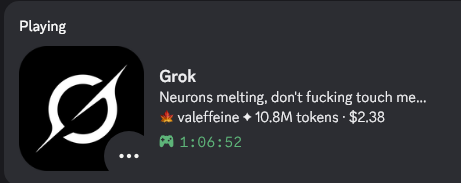
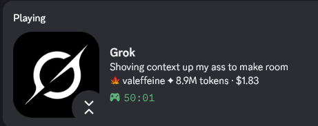
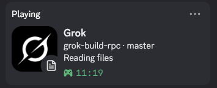
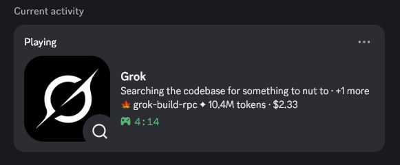

<div align="center">

<picture>
  <source media="(prefers-color-scheme: dark)" srcset="docs/logo/logo-white.png">
  <source media="(prefers-color-scheme: light)" srcset="docs/logo/logo-black.png">
  
</picture>

# Grok Build RPC

**Show what [Grok Build](https://x.ai) is doing on your Discord profile.**

<a href="https://github.com/caffeinepx/grok-build-rpc/actions/workflows/ci.yml"></a>
<a href="https://github.com/caffeinepx/grok-build-rpc/releases/latest"></a>
<a href="LICENSE"></a>


<br><br>






</div>

Your project, branch and what Grok is doing right now (thinking, editing, running a command…) show up live on Discord. It clears itself when Grok exits.

## Install

Needs Linux (x86_64 or arm64), Grok Build and the Discord desktop app.

```sh
curl -fsSL https://raw.githubusercontent.com/caffeinepx/grok-build-rpc/main/install.sh | sh
```

Then open a new Grok session. That's it.

The script installs to `~/.local/bin` without sudo and asks whether to start at login with systemd. Add `sh -s -- --systemd`, `--version v0.1.0` or `--uninstall` to skip the question or do something else. You can also grab a binary from [Releases](https://github.com/caffeinepx/grok-build-rpc/releases) or build it with `cargo install --git https://github.com/caffeinepx/grok-build-rpc`, then run `grok-rpc install`.

## Presets

Four text packs come built in: `default`, `unhinged`, `mommy` and `nsfw`. The last three are 18+, and `default` stays on until you switch.

```sh
grok-rpc preset           # list packs
grok-rpc preset unhinged  # switch (applies immediately)
```

## Configure

Edit `~/.config/grok-rpc/config.toml`. Changes apply when you save.

```toml
[display]
details = "{activity}[ · {sessions}]"
state   = "{project}[ · {branch}]"

[privacy]
show_file_names = true   # "Editing main.rs" instead of "Editing code"
```

By default only the project, branch, model and kind of activity are shown. File names, command names, token stats and session titles are opt-in. Full commands and prompts are never sent.

See **[docs/config.md](docs/config.md)** for every variable, custom presets, buttons and hidden projects.

## Commands

```sh
grok-rpc status          # what's running and what Discord is showing
grok-rpc pause / resume  # hide or show the presence
grok-rpc preview         # see every state with your config
grok-rpc config check    # validate the config
```

Nothing showing up? Run `grok-rpc status`, and check Discord's *Settings → Activity Privacy → Share your detected activities*. Logs are in `~/.local/state/grok-rpc/daemon.log`.

## License

[MIT](LICENSE). Icons from [Lucide](https://lucide.dev) (ISC). Not affiliated with xAI or Discord.
